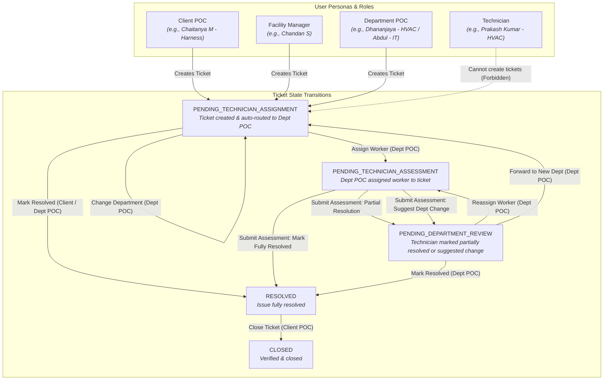
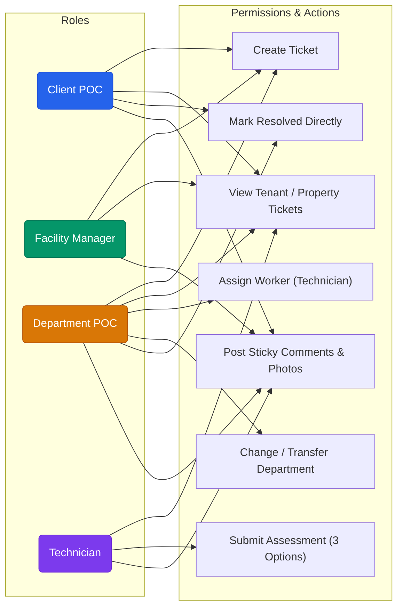
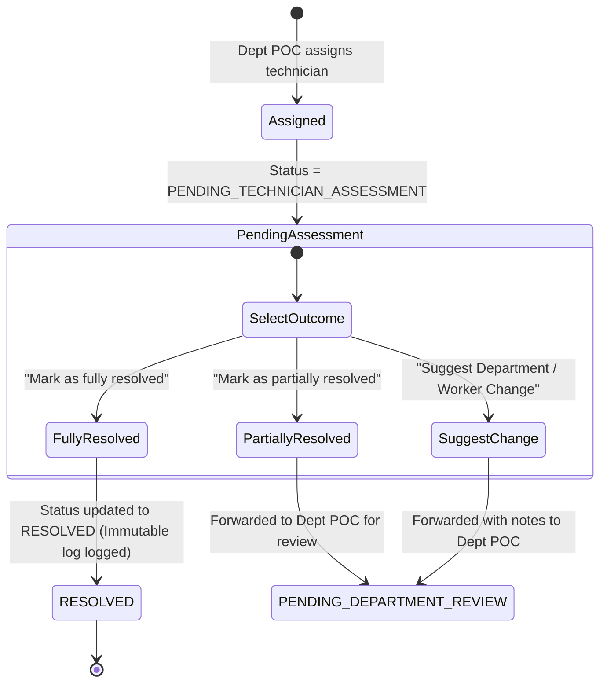

# UrbanVault Facility Management & Ticketing Desk

A modern, production-minded ticketing and facility management platform built for **UrbanVault** (managed workspace & flexible office operator) to triage, route, assign, and resolve physical facility issues across office locations.

Built with **React 18**, **Material UI (MUI v5)**, **Vite**, **Python 3.12**, **Django 5**, **Django REST Framework**, and **SQLite / PostgreSQL**.

---

## 1. Quick Start Guide (How to Run Locally)

Follow these steps to clone and run the project from scratch.

### Prerequisites
- **Python 3.9+** (Supports Python 3.9, 3.10, 3.11, and 3.12)
- **Node.js 18+** & **npm**

---

### Step 0: Clone the Repository

Open your terminal:

```bash
git clone https://github.com/PrabhanjanJois/urbanvault-ticketing_JOIS.git
cd urbanvault-ticketing_JOIS
```

---

### Step 1: Start the Backend (Terminal 1)

In your terminal, navigate to `backend` and run:

```bash
cd backend
python3 -m venv .venv
source .venv/bin/activate
pip install -r requirements.txt
python manage.py migrate
python manage.py seed_data
python manage.py runserver 127.0.0.1:8000
```

> [!NOTE]
> The backend server will be live at `http://127.0.0.1:8000/`.
> - API Base URL: `http://127.0.0.1:8000/api/`
> - Django Admin: `http://127.0.0.1:8000/admin/`

---

### Step 2: Start the Frontend (Terminal 2)

Open a **new terminal tab or window**, navigate to `frontend`, and run:

```bash
cd frontend
npm install
npm run dev
```

> [!TIP]
> Open **[http://localhost:3000](http://localhost:3000)** in your browser. 
> The application includes a **1-Click Persona Switcher** in the top navigation bar to test all user roles without passwords.

---

### Alternative: Run with Docker Compose
If you prefer running everything in containers:

```bash
# From project root
cp .env.example .env
docker compose up --build
```
Access the frontend at `http://localhost:3000`.

---

## 2. Automated Test Suites

### Backend Tests (Pytest)
Runs state machine assertions, permission constraints, and image upload tests:
```bash
cd backend
source .venv/bin/activate
pytest ticketing/tests/ -v
```

### Frontend Tests (Vitest)
Runs component tests for ticket forms, quick issue pills, tour logic, and double-submit prevention:
```bash
cd frontend
npx vitest run
```

---

## 3. Beyond the Wireframe: Added Value Features

Several major architectural and usability features were implemented that went beyond the basic assignment wireframe to make the platform feel like a finished, enterprise-grade SaaS product:

### 1. Interactive Guided Product Tour (`driver.js`)
- **Dedicated Tour Button**: Located at the extreme left of the navigation actions bar.
- **10 Step Interactive Walkthrough**: Highlights ticket tabs, search & filters, persona switching, ticket creation modal, quick-issue autofill, activity timeline, and technician assessments.
- **Dedicated "Skip Tour" Action**: Reviewers can dismiss or exit the tour at any time with one click.
- **Themed Tooltips**: Custom CSS ensures tour dialogs look native in both Light and Dark themes with smooth auto-scrolling.

### 2. Dark & Light Mode Theme Engine
- **One-Click Theme Toggle**: Located in the top navbar.
- **MUI Dynamic Palette**: Curated dark slate background (`#0B0F19`), high-contrast text, glassmorphism cards, and subtle borders.
- **State Persistence**: Theme preference is saved locally across page reloads.

### 3. Photo & Image Attachments (Multi-file Upload)
- **Ticket Creation Attachments**: Users can attach multiple photos (e.g. leaking AC, damaged desk, flickering light fixture) when submitting a ticket.
- **Timeline Comment Attachments**: Technicians and staff can attach proof-of-work images directly inside the sticky comment stream.
- **Image Previews & Modal Viewer**: Uploaded images show preview thumbnails with remove buttons before submitting, thumbnail chips on dashboard cards, and a modal lightbox viewer.

### 4. Full Mobile & Tablet Responsiveness
- **Adaptive Breakpoints**: Custom layouts tailored for mobile phones (`<600px`), portrait tablets (`600px - 900px`), and desktop monitors (`>900px`).
- **Mobile Split View**: On mobile and portrait tablets, the 2-column view transitions into a clean full-width card list. Tapping any card opens a dedicated modal with a prominent **"Back to List"** button.
- **Single-Column Filters**: Search and status filter grids adapt dynamically on compact screens.

### 5. Strict Role-Based Ticket Creation Rules
- **Technician Guardrail**: Prevented technicians from creating tickets (technicians are executors of assigned work; issues must be raised by Client POCs, Facility Managers, or Department Managers).
- **Dynamic Quick Issues**: Quick-issue pills dynamically adapt to the selected client's ticket history.

---

## 4. Roles, Permissions & Flow Architecture (Mermaid Diagrams)

### Diagram 1: Role Hierarchy & Ticket Lifecycle



---

### Diagram 2: Role Permissions Matrix



---

### Diagram 3: Assessment Decision Tree for Technicians



---

## 5. Seeded User Personas Reference

Use the **Persona Switcher** in the navbar to test different roles:

| Role | Username | Full Name & Title | Assigned Entity | Key Capabilities |
| :--- | :--- | :--- | :--- | :--- |
| `CLIENT_POC` | `client_chaitanya` | Chaitanya M (Client POC) | Client: Harness (Floors: 2F, 3F) | Create tickets for Harness; view tenant tickets; comment; Mark Resolved CTA. Cannot assign workers or view other clients. |
| `FACILITY_MANAGER` | `fm_chandan` | Chandan S (Facility Manager) | Property: Harness-1317 (and others) | Create tickets across clients; monitor tickets in managed properties; comment; operational oversight. |
| `DEPARTMENT_POC` | `dept_dhananjaya` | Dhananjaya Murthy (Technical Manager) | Department: Technical / HVAC | View department tickets; **Assign Worker (Technician)**; **Change Department** (with forwarding note); mark resolved. |
| `DEPARTMENT_POC` | `dept_abdul` | Abdul (IT Manager) | Department: IT & Networks | View IT department tickets; Assign IT worker; Change department; mark resolved. |
| `TECHNICIAN` | `tech_prakash` | Prakash Kumar (Technician) | Department: Technical / HVAC | View assigned tickets; **Submit Assessment** (Fully Resolved, Partially Resolved, Suggest Change); comment with photo uploads. |

---

## 6. Engineering & Production Highlights

1. **Audit Log & Activity Record**:
   - Every status transition, worker assignment, and department transfer creates an immutable `TicketActivity` record capturing actor, action type, timestamp, and contextual metadata (`old_status`, `new_status`, `assigned_from`, `assigned_to`, `forwarding_note`).

2. **Atomic Operations (`@transaction.atomic`)**:
   - Multi-step write actions (ticket creation + auto-routing + logging activities) execute inside `@transaction.atomic` blocks to prevent partial database states.

3. **Query Optimization & Zero N+1 Bottlenecks**:
   - `select_related('client', 'property', 'department', 'created_by', 'assigned_to')` and `prefetch_related('activities__actor', 'comments__author')` across all viewsets.
   - Database composite indexes for high-throughput dashboard filtering (`['status', '-created_at']` and `['client', 'status']`).

4. **Async Tasks & Celery Idempotency**:
   - Notification dispatching utilizes Celery with Redis broker and Redis idempotency keys (`idempotency:ticket_notify:{ticket_id}:{event_type}`) to prevent duplicate webhook/email triggers.

---

## 7. AI-Assisted Development Disclosure

In accordance with the assignment guidelines, AI-assisted development tools (Claude / Gemini coding assistants) were utilized for:
- Accelerating initial boilerplate scaffolding and schema syntax definitions.
- Formatting mock seed datasets with realistic persona metadata.
- Generating unit test edge case assertions for state transition rejections.

All business logic state machine designs, role authorization matrix checks, Celery idempotency implementations, and UI component integrations were designed, reviewed, and validated for correctness.
